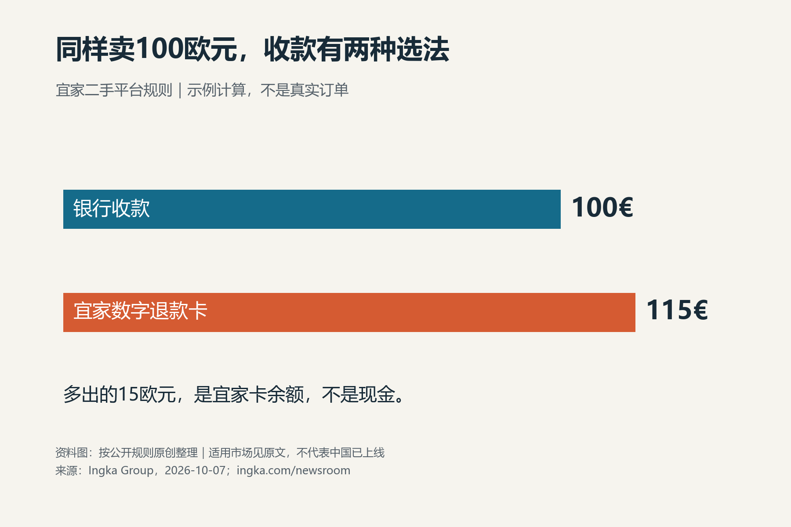
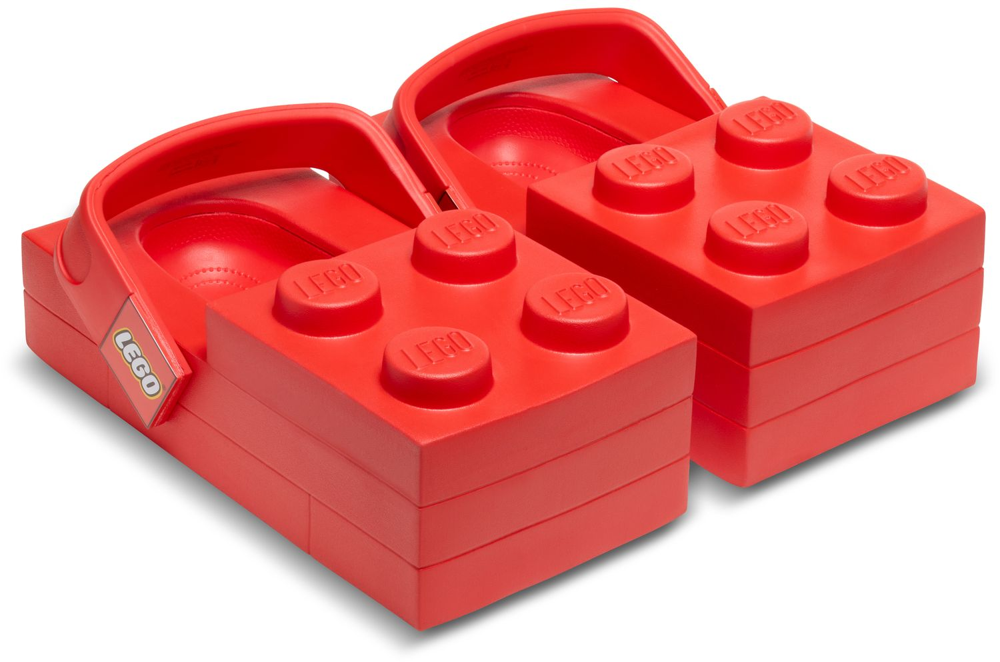
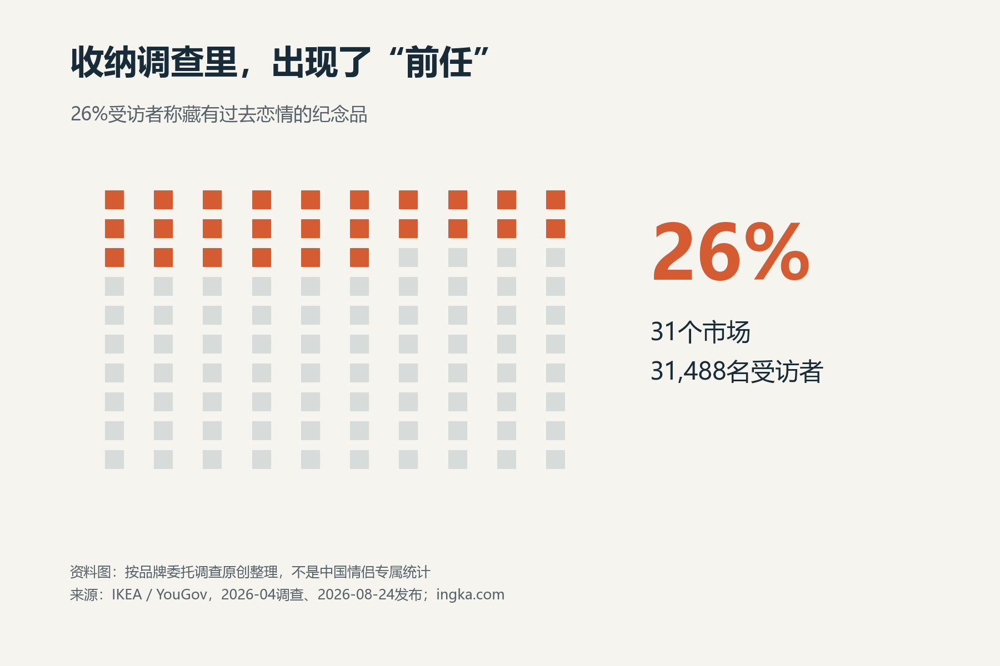
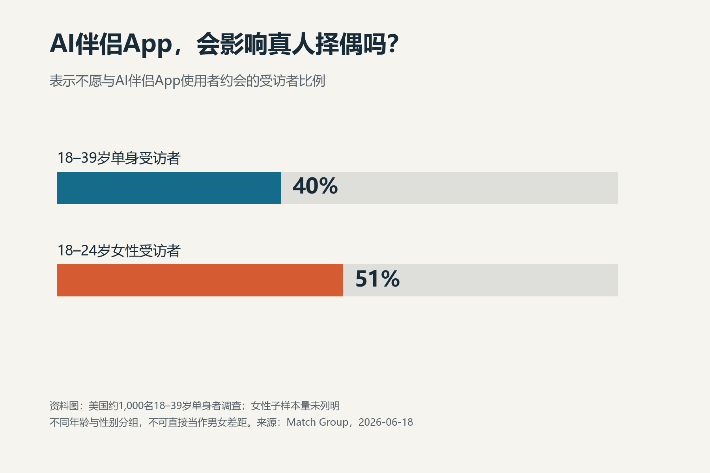
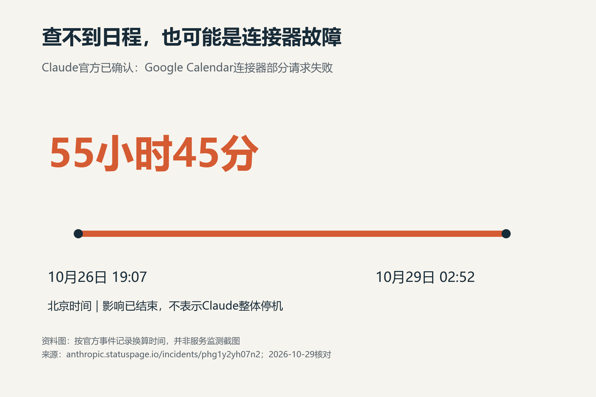

# 10月29日下午重新选题与原创稿

## 依据与覆盖

午间确认助手酒店稿约3.1h为210浏览/0转帖，乌鸦稿2h为107/0；并无传播改善。更晚的午饭帖约1.4h为388/0。同龄样本不足，不能从这些数字证明因果；本轮根据实际稿件问题重选，不宣布已找到爆款公式。

本轮重新读取Nina、Souro、数原律三个榜单详情页（页面更新约13:41—13:42），近期高曝光五帖与上午大致相同；没有冒称读到五篇新爆款。Nina商品价格帖约101.3万，Souro视觉想象帖约144.4万，数原律情节反转帖约139.5万，均为当前累计/第三方记录，不是今天新增。只借鉴具体价格与选择机制、真实关系边界、情境和画面，不搬其成帖。

50条独立一手线索保存在50条一手来源线索.json，属于机构索引/官方故障订阅发现，不等于50件新闻均全文核实。补查LEGO Brick Clog和Match AI伴侣调查两条；最终5稿核实全文及关键数字。未选的47条不填造核验结论。脚本日志显示Match目录HTTP 403，选中调查正文由网页检索工具成功读取。

本批同时重选题材和媒体，是探索性内容批次，不是单变量因果试验。相对优先顺序仅编辑判断；无流量效果承诺。四张配图为按事实制作的原创资料图，不伪造官方界面、用户聊天、订单或实验；第五张为LEGO官方产品原图。原始照片与资料图分别标明。

## A｜先看清多出来的15%是什么

> 好家伙，宜家连你卖旧家具的钱都想留下。
>
> 它的欧洲二手平台，卖家能选银行收款，也能换成多15%的宜家卡余额。
>
> 按卖出100欧元算：拿钱是100，拿卡是115。多出来的15欧元，得回宜家花。

原始来源：[Ingka Group，2026-10-07官方公告](https://www.ingka.com/newsroom/ikea-to-test-direct-offers-to-sellers-through-its-second-hand-marketplace-as-the-platform-expands-to-the-uk-and-ireland/)。原文明确银行转账或多15%价值的宜家数字退款卡；平台在当时欧洲八个市场上线，次周德国第九。不扩大为中国可用。100欧元是计算示例，不是真实交易，15%卡余额不是现金收益。

看点：明确可算的两种选择，以及品牌把二手交易接回自身消费的机制；学习Nina具体金额与交易对象的选题，不虚构价格炒作。末句前的品牌意图是自己的经营观察，非官方动机声明。

配图：原创资料图，图内含示例、适用地区和来源；未复用宜家新闻照片或商标。状态：可人工审核发布。发布登记字段：链接/实际时间/24h/72h浏览与转帖，均待真实采集。

## B｜正式商品的荒诞感，由原图承担

> 好家伙，乐高和Crocs真出了一双“红砖鞋”。
>
> 美国官网标149.99美元，鞋面四个凸点，随鞋还配一只穿同款的小人。
>
> 我今天查到的尺码列表，是一排售罄。

原始来源：[LEGO 2026-01-23合作公告](https://www.lego.com/es-us/aboutus/news/2026/january/the-lego-group-and-crocs-enter-multi-year-global-partnership)、[美国官网产品5010203](https://www.lego.com/en-us/product/brick-clog-5010203)。首发2026-02-16，不冒充10月新品；本次10月29日约13:51—13:57读取页价149.99美元、列出的尺码M5/W7至M13/W15均显示Sold out。仅本次美国官网读取状态，不推断全球售罄、销量或转售价格。材质是Croslite，不能写成硬积木踩脚。

配图：原图未编辑，©2026 The LEGO Group。[LEGO官方媒体图片规则](https://www.lego.com/en-id/aboutus/newsroom/media-assets)允许Group自有照片用于编辑出版并要求此署名；本稿作商品介绍/评论，不作广告、商标背书或单独转售图片。图片地址：https://www.lego.com/cdn/cs/set/assets/blt681a8f2de6baa290/5010203_Prod.png?dpr=1&fit=bounds&format=jpg&height=1500&quality=80&width=1500 。已目视完整红色鞋原图，图中未展示小人；小人信息来自公告和规格文字。

看点：真实商品造型＋明确官方价格＋所读尺码状态，不依靠一张普通照片再加无关俏皮话。借鉴具体物件反差与画面先行，不照搬其他X账号故事。状态：可人工审核发布，保留署名；旧案例的新一次商品页观察，发布前价格/库存可能变化。

## C｜收纳和关系边界的具体交点

> 嘶，收纳调查还能翻出前任。
>
> 宜家委托YouGov调查31个市场、31,488人，26%说自己藏着过去恋情的纪念品。
>
> 同居时分衣柜，可能还得谈一件事：哪些旧物要留下，哪些需要提前告诉对方。

原始来源：[Ingka Group，2026-08-24发布](https://www.ingka.com/newsroom/new-global-ikea-study-nearly-4-in-10-are-staging-a-silent-protest-over-household-mess/)。2026年4月YouGov受品牌委托，对31个市场31,488人开展调查。26%为新闻稿报告的纪念品回答，不是“中国26%情侣”、不是现任出轨比例；同居建议为原创观点。原报告PDF约83MB未完成下载/问卷逐题核对，采用已读品牌首发摘要与方法说明，不能冒充独立学术定论。

看点：具体旧物与共同居住边界，读者可讨论真实生活中的知情与保留问题；没有虚构情侣、聊天记录或编造背叛故事。配图是数据整理，不拍陌生情侣摆拍或假装搜出私人旧物。

状态：可人工审核发布，明确品牌委托调查和日期；旧调查延伸选题，不是今日热点。

## D｜AI伴侣与真实择偶条件

> 欸，择偶条件里，已经出现了“能不能接受AI伴侣”。
>
> Match调查约1000名美国18—39岁单身者，40%表示不会和AI伴侣App的使用者约会；18—24岁女性受访者中是51%。
>
> 用AI处理工作，和用AI获得恋爱式陪伴，确实需要分开谈。

原始来源：[Match Group Research Team，2026-06-18](https://mtch.com/news/ai-is-everywhere-romance-is-still-off-limits/)，调查时间2026-04-13至05-08，约1000名美国18—39岁单身成人。40%由two in five换算；51%为18—24岁女性子组。子样本量未列明；年龄与性别组同时变化，不能称女性比男性高11个百分点。品牌研究利益关系保留，不推成全球标准；态度题不能写成实际分手率、也不能指认某个人出轨。

看点：不是笼统说AI改变恋爱，而是一个明确的择偶拒绝条件；关系边界与账号技术受众交叉。图表对应具体态度题，原始数据与自己的观点分开。

状态：可人工审核发布，注明旧调查及美国样本；配图原创事实图表，不借用调查品牌照片。

## E｜今天刚恢复的具体故障

> 哎，Claude查不到日程，真不一定是提示词没写好。
>
> 官方确认，Google Calendar连接器部分请求出错，影响从26日持续到29日凌晨，跨度55小时45分，目前已恢复。
>
> 这几天靠它查过会议的，值得回原始日历核对一次。

原始来源：[Claude官方事件记录](https://anthropic.statuspage.io/incidents/phg1y2yh07n2)。原文影响11:07 UTC Oct26至18:52 UTC Oct28；北京时间10月26日19:07至29日02:52，共55h45。恢复通报Oct28 20:05 UTC即29日04:05。部分列举/搜索日历事件请求失败，涉及claude.ai、Claude Code及Cowork。不是全服务连续宕机，也不代表期间每个用户所有请求都失败；不声称有会议被删除或数据泄露。

看点：最近发生、有明确影响窗口、与用户实际工作有关；提供核对路径，不编造个人故障经历。配图为自行换算的时间线，不伪装服务官方截图。状态：可人工审核发布；恢复事件回顾，不写仍在故障。

## 初筛与发布边界

内部五维按反差/理解/分享/信度与可用/讨论初筛：A为4/5/4/4/4，B为4/5/4/4/4，C为4/5/4/3.5/5，D为4/4/4/3.5/5，E为3.5/4/4/5/3；仅选题排序，不是流量预测。品牌调查得分包含方法与利益关系限制，不能因数字大认定更可靠。

不要求连续发完五条。先按实际时间登记一条，再取得后续同龄24h/72h快照；当前所有发布链接和结果为null。即使表现改变，也无法从本批多变量探索单独归因于配图或语气词。优先保留用户原始来源与原创要求，不自动发布、点赞或评论。
