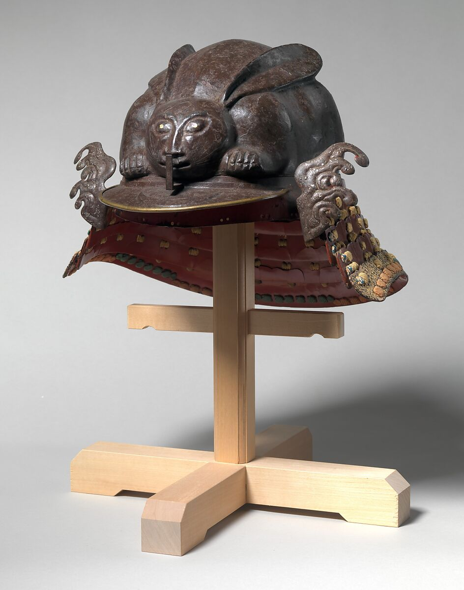
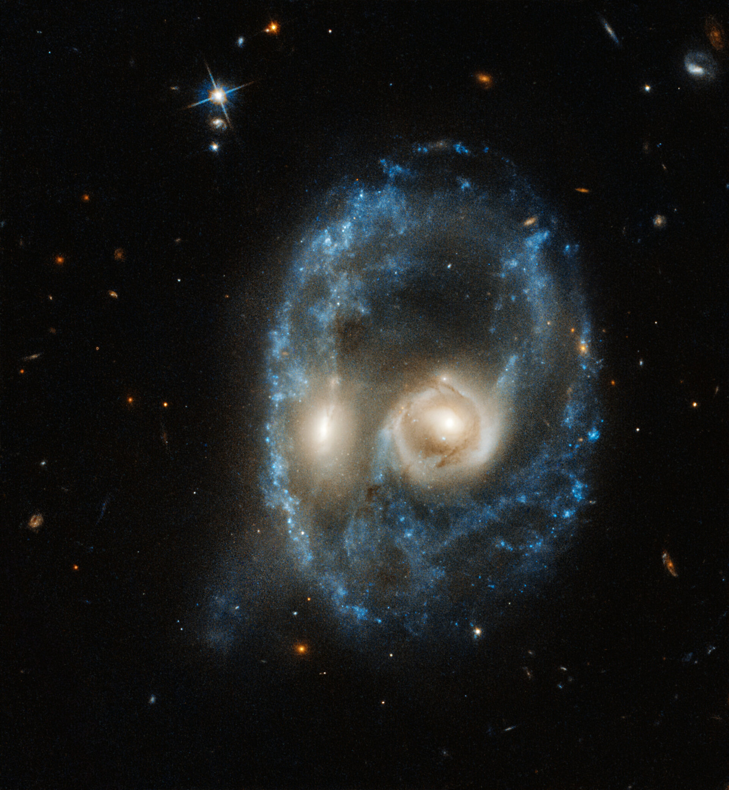
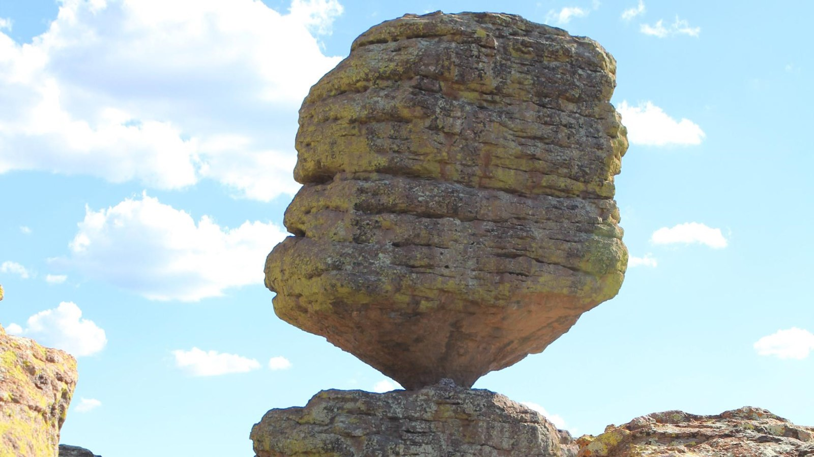
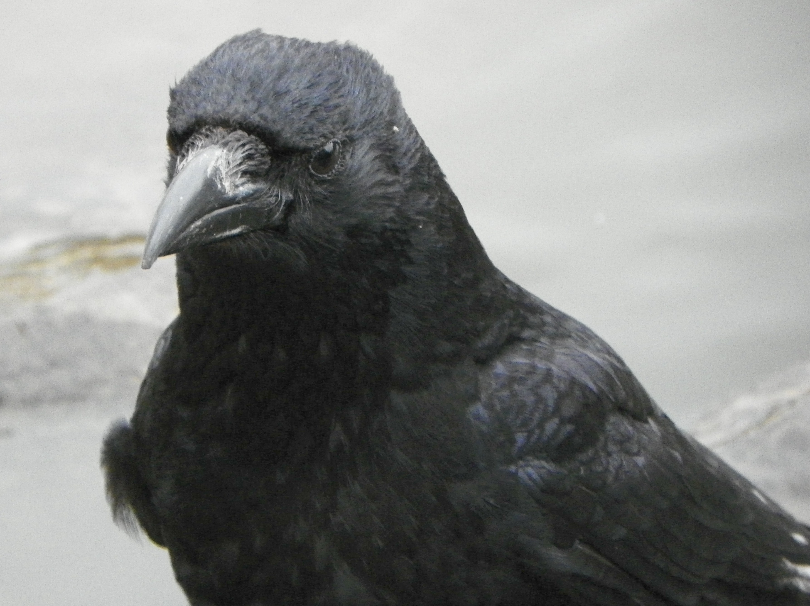

# 原创稿与原始素材｜2026-10-29

本轮实际交付4条，4张图均已打开核对。文案本轮独立创作，素材从博物馆、ESA、NPS和大学/研究论文取得；未用其他X账号的成帖改配文。不声称题材全网首发。对标只借鉴Nina的具体事实与反差、Souro的画面先行，不照搬其具体选题。

筛查另涉及NASA岩石介绍、NASA木卫掩食线索、吉尼斯296只狗泳池纪录及摄影赛事；未完成全部逐项核验或无明确媒体转用许可的，不列为可发布稿。本文件不是50条已核验素材池，也不把此前50条X原帖线索充作本次一手素材筛选完成数。

## 1｜兔形铁头盔

> 笑死，17世纪的铁头盔，做成了一只趴着的兔子。
>
> 别人顶着杀气，他顶着兔兔。

原始来源：[大都会博物馆，藏品07.48](https://www.metmuseum.org/art/collection/search/22098)。藏品17世纪，网页未标发布日期；不是新出土新闻。馆方说明整体铁制头盔呈蹲伏兔形，饰片涉及能剧典故。后一句是原创玩笑，不是史料引述。

图片：The Metropolitan Museum of Art, Rogers Fund, 1907，Public Domain。原图：https://collectionapi.metmuseum.org/api/collection/v1/iiif/22098/62278/main-image 。原图未编辑；从博物馆开放藏品页下载。状态：可发布，人工审核。

看点：实际盔甲与可爱造型形成反差，一张图即能读懂。初筛五维4/5/4/5/3，加权4.3，仅编辑评分，不是预测曝光。

## 2｜宇宙鬼脸

> 卧槽，两座星系撞出了一张脸。
>
> 宇宙过万圣节，连化妆都省了。

原始来源：[ESA：Hubble captures cosmic face](https://www.esa.int/ESA_Multimedia/Images/2019/10/Hubble_captures_cosmic_face)，2019-10-28发布，2019-06-19观测。两个相近大小星系相撞形成类似面孔的结构，距地球约7.04亿光年。节日联想为原创表达；明确是旧图重看，不是2026新发现。

发布时保留图源行：NASA, ESA, J. Dalcanton, B.F. Williams, M. Durbin (University of Washington)，[CC BY 4.0](https://creativecommons.org/licenses/by/4.0/)，原图未编辑。图片直链：https://www.esa.int/var/esa/storage/images/esa_multimedia/images/2019/10/hubble_captures_cosmic_face/21128263-1-eng-GB/Hubble_captures_cosmic_face_pillars.jpg 。状态：可发布，保留署名、来源和旧图日期。

看点：真实天文画面与万圣节时间点相接，正文只给读图方向。初筛4/5/4/5/3，加权4.3。

## 3｜平衡巨石

> 嘶，亚利桑那这块平衡石，看得人说话都想小点声。

原始来源：[NPS：Big Balanced Rock](https://www.nps.gov/places/big-balanced-rock.htm)，页面更新2021-05-07，图片拍摄日未提供。地点为美国亚利桑那州Chiricahua区域。本稿只描述实际画面及主观感受，不声称它即将倒塌、声音能震倒、或已知重量。

图片署名：NPS Photo，官方原图，无第三方署名；按[NPS版权说明](https://www.nps.gov/aboutus/disclaimer.htm)的政府作品规则使用，保留出处。不使用NPS标志作背书。图片直链：https://www.nps.gov/common/uploads/cropped_image/primary/D7582E6E-9067-AFAE-25FC338689AE7F61.jpg?mode=crop&quality=90&width=1600 。下载的是源站公开的裁切尺寸，本地未编辑。状态：可发布，人工审核。

看点：巨大上部与很窄的接触面产生直观紧张感，不需要编造事故。初筛4/5/4/5/3，加权4.3。

## 4｜乌鸦判断圆点方向

> 好家伙，实验里两只乌鸦判断圆点往哪边动，平均只用0.235秒。
>
> 乌鸦已经交卷，人类还在选午饭。

原始来源：[图宾根大学，2026-10-22研究新闻](https://uni-tuebingen.de/fakultaeten/mathematisch-naturwissenschaftliche-fakultaet/fachbereiche/informatik/lehrstuehle/neuronale-informationsverarbeitung/news/newsfullview-aktuell/article/kraehen-entscheiden-doppelt-so-schnell-wie-menschen-und-affen/)，[论文Ultrarapid decision-making in an avian brain](https://doi.org/10.1126/science.aed6459)，Science，2026-10-22；[PubMed摘要](https://pubmed.ncbi.nlm.nih.gov/42912155/)。235毫秒是两只小嘴乌鸦在特定视觉运动辨别任务中的平均反应，不能扩大为所有决策、更高智商或所有乌鸦。末句为原创玩笑，无人类选午饭耗时的实验主张。

图源行须保留：物种配图，非实验现场；AnemoneProjectors，[原作/授权页](https://commons.wikimedia.org/wiki/File:Carrion_Crow_aka_Corvus_corone.jpg)，[CC BY-SA 2.0](https://creativecommons.org/licenses/by-sa/2.0/)，2011-04-05拍摄，原图未编辑。图片直链：https://upload.wikimedia.org/wikipedia/commons/8/8c/Carrion_Crow_aka_Corvus_corone.jpg 。大学实验图未确认社交账号转用许可，因此不用它充当已获授权配图。状态：可发布，保留配图性质、署名和授权链接。

看点：具体实验数字配日常选择困难的轻松反差，不夸大科研。初筛4/5/4/4/3，加权4.1。

## 后续复核

均尚未发布，无24h/72h表现。发布后人工记录链接、实际时间、题材与形式，再用同龄数据判断保留哪种表达。不得把本轮编辑评分当成增长验证。不会自动发布、评论或点赞。
